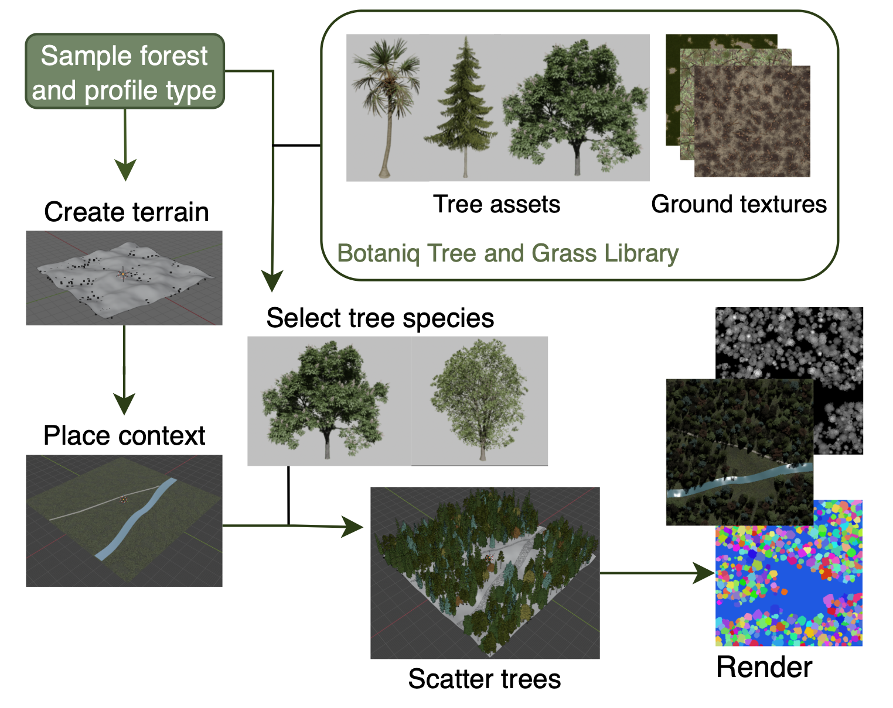
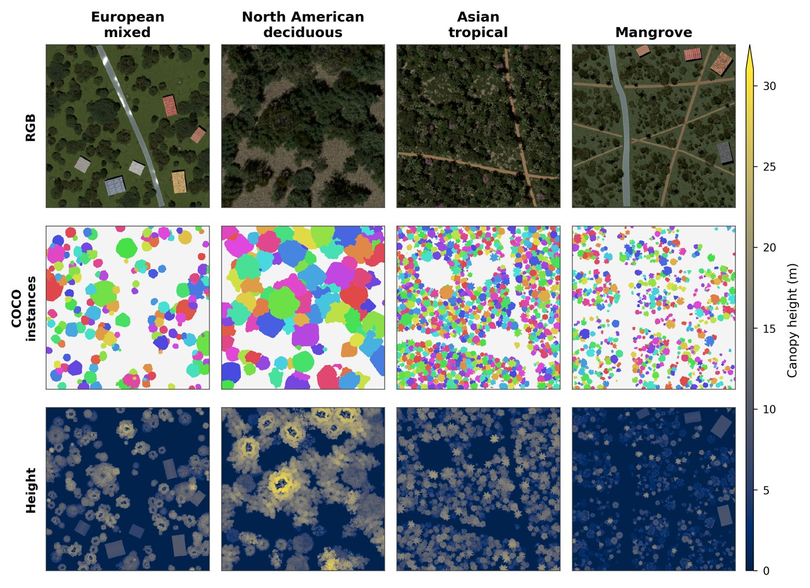
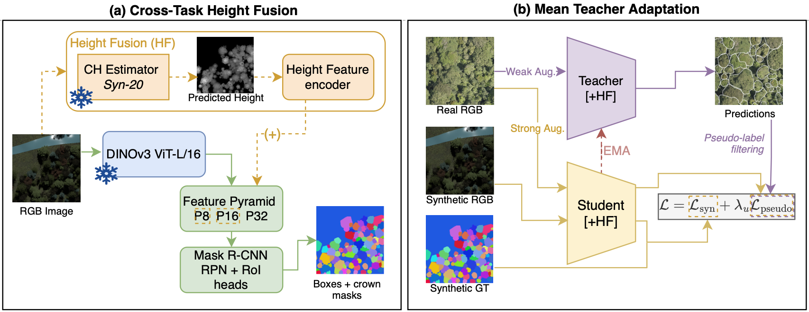

# SynthForest: A Multi-Task Synthetic Dataset for Real-World Forest Vision

**Iaroslava Novoselova<sup>1,2</sup>, Jian Song<sup>1,3</sup>, Naoto Yokoya<sup>1,3</sup>**

<sup>1</sup>RIKEN AIP, Japan · <sup>2</sup>ETH Zürich, Switzerland · <sup>3</sup>The University of Tokyo, Japan

[CV4EO @ WACV 2027](https://geoai.ornl.gov/cv4eo-wacv/)  · [Paper](PAPER_URL) · [Dataset](https://huggingface.co/datasets/novoselova/synthforest) · [Model weights](https://huggingface.co/novoselova/synthforest)

<p align="center">
  
  <br><em>Generation workflow: sampled forest and structural priors determine terrain, context, species composition and tree placement; rendering produces aligned RGB and geometry-derived annotations.</em>
</p>

SynthForest is a procedurally generated dataset of overhead forest imagery with
spatially aligned **RGB, metric canopy height, tree-instance masks and bounding
boxes**, all derived from known 3D scene geometry. Scenes are generated in
Blender from 62 tree species organised into 11 regional forest configurations
and three structural profiles. This repository contains the scene generator and
the code to train and evaluate the canopy-height and crown-delineation models of
the paper on 12 real-world benchmarks.

<p align="center">
  
  <br><em>Example scenes with aligned RGB, crown instances and canopy height.</em>
</p>

## Highlights

- **Dataset.** 235 crown-delineation scenes (5 cm GSD, 109k visible crowns) and
  700 canopy-height scenes (10 cm GSD, ~1M trees), covering 11 forest types,
  3 structural profiles and 62 species.
- **Canopy height.** A DINOv3 + DPT model trained only on SynthForest (*Syn-20*)
  outperforms the SynRS3D-based RS3DAda model on 10 of 12 dataset–metric
  comparisons and a real NEON-trained model on France and Virtual Shizuoka.
- **Cross-task transfer.** Canopy height predicted by Syn-20 is fused into a
  Mask R-CNN detector and consistently improves crown delineation.
- **Label efficiency.** With SynthForest pre-training, 15 % of the BAMForests
  labels recover 99.2 % of the full-data real-only in-domain performance.

## Method

<p align="center">
  
  <br><em>(a) Syn-20 height predictions are encoded and fused into the detector feature pyramid. (b) Mean Teacher adapts the detector with pseudo-labels on unlabeled real imagery.</em>
</p>

All models use a frozen DINOv3 ViT-L/16 encoder; only the task heads are trained.

| Component | Description | Config |
| --- | --- | --- |
| Syn-20 | DPT canopy-height head trained on SynthForest at 20 cm | `configs/height/train_syn20.yaml` |
| Crown detector | Mask R-CNN on a DINOv3 feature pyramid | `configs/crowns/training/synthetic.yaml` |
| Height fusion (HF) | Syn-20 height encoded and added to P8/P16 | `configs/crowns/training/synthetic_hf.yaml` |
| Mean Teacher (MT) | EMA teacher pseudo-labels on unlabeled real imagery | `configs/crowns/training/synthetic_mt.yaml`, `synthetic_hf_mt.yaml` |
| Fine-tuning | HF+MT model fine-tuned on fractions of real labels | `configs/crowns/finetuning/*.yaml` |

Synthetic images are additionally adapted to unlabeled real imagery with
histogram matching, pixel-distribution adaptation and Fourier-domain adaptation.

## Results

**Canopy-height estimation** (MAE in m, lower is better; full table in
[docs/reproduction.md](docs/reproduction.md)).

| Training data | France | NEON | São Paulo | V. Shizuoka |
| --- | ---: | ---: | ---: | ---: |
| Real (NEON) | 3.59 | **2.69** | **3.33** | 9.11 |
| RS3DAda (SynRS3D) | 5.29 | 4.14 | 6.47 | 14.90 |
| **SynthForest (Syn-20)** | **2.58** | 4.33 | 4.79 | **8.26** |

**Crown delineation** (bounding-box mAP50:95 averaged over 8 benchmarks; no real
labels used for the synthetic models).

| Model | Macro mAP | MT-held-out mAP | Macro RF1@75 |
| --- | ---: | ---: | ---: |
| Mask R-CNN (SynthForest) | 15.12 | 15.36 | 17.28 |
| + height fusion | 15.49 | 15.81 | **17.77** |
| + Mean Teacher | 15.65 | 15.76 | 16.39 |
| + height fusion + Mean Teacher | **15.91** | **16.08** | 16.77 |

## Installation

```bash
git clone REPO_URL synthforest
cd synthforest
conda create -n synthforest python=3.12 gdal && conda activate synthforest
pip install -e ".[training,geospatial]"
synthforest doctor
```

DINOv3 ViT-L/16 weights are expected at `$SYNTHFOREST_MODEL_ROOT/dinov3-vitl16`.
See [docs/installation.md](docs/installation.md) for details.

## Usage

Everything is run through the `synthforest` command (`synthforest --help` lists
all subcommands). Data locations are set with environment variables:

```bash
export SYNTHFOREST_DATA_ROOT=/path/to/real/data      # real benchmarks
export SYNTHFOREST_OUTPUT_ROOT=/path/to/outputs      # SynthForest + runs
export SYNTHFOREST_MODEL_ROOT=/path/to/models        # DINOv3 + checkpoints
```

**Train and evaluate on SynthForest.** Download the dataset into
`$SYNTHFOREST_OUTPUT_ROOT/synthforest/`, then:

```bash
# canopy height
synthforest train height --config height/train_syn20
synthforest evaluate height --config height/benchmark/france_raster \
  --run-folder <run> --checkpoint-name last.pth

# crown delineation
synthforest train crowns --config crowns/training/synthetic
synthforest evaluate crowns --config crowns/benchmark/maskrcnn \
  --run-folder <run> --checkpoint-name last.pth
```

**Generate new scenes.** Generation runs in Blender 4.1 and requires the
commercial [Botaniq](https://polygoniq.com/3d/botaniq/) tree library, which we
cannot redistribute. Without it, the generation commands report that Botaniq is
missing; everything else works with the released dataset.

```bash
synthforest generate asset-pool
synthforest generate scenes --config-name tree_scatter_scene \
  generation.num_scenes=40 'generation.target_profile_weights={large_closed_canopy:1}'
```

## Documentation

| Document | Contents |
| --- | --- |
| [installation.md](docs/installation.md) | environment, DINOv3, Blender |
| [generation.md](docs/generation.md) | scene generation, dataset batches, tiling |
| [data.md](docs/data.md) | real benchmarks, expected directory layout, path variables |
| [reproduction.md](docs/reproduction.md) | commands and expected numbers for every table and figure |

## Repository structure

```text
configs/                 experiment configs (generation, height, crowns)
src/synthforest/
├── cli.py               `synthforest` command
├── commands/            command implementations
├── tree_scatter/        Blender scene generator and forest priors
├── postprocessing/      downsampling and tiling of rendered scenes
└── training/            datasets, models, training, evaluation
tests/                   unit tests (CPU, no data required)
```

## License and acknowledgements

The code is released under the [MIT License](LICENSE). The
[SynthForest dataset](https://huggingface.co/datasets/novoselova/synthforest) and
[model weights](https://huggingface.co/novoselova/synthforest) are released under
[CC BY 4.0](https://creativecommons.org/licenses/by/4.0/). The Botaniq library,
DINOv3 weights and the real benchmark datasets are subject to their own
licenses. Real crown benchmarks are used through the
[CanopyRS](https://github.com/hugobaudchon/CanopyRS) preprocessing, and the
DPT head and Mean Teacher follow Ranftl et al. (2021) and Tarvainen & Valpola
(2017).
